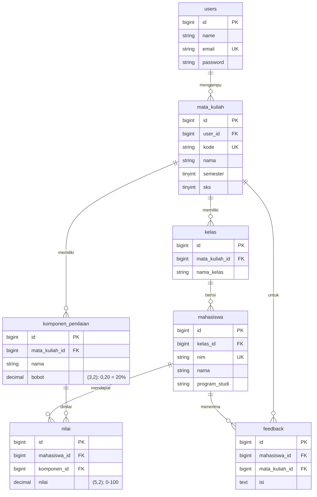

# ERD — Sistem Penilaian Tugas Mahasiswa

Diagram relasi entitas aplikasi sesuai skema `database/migrations` (setara
dengan `database/schema.sql`).

## Keterangan Umum

| Entitas | Peran | Catatan |
| --- | --- | --- |
| `users` | Dosen (satu-satunya peran pengguna) | Mahasiswa **tidak** punya akun login sesuai PRD |
| `mata_kuliah` | Mata kuliah yang diampu dosen | `kode` unik |
| `kelas` | Rombongan belajar per mata kuliah | Unik per pasangan `(mata_kuliah_id, nama_kelas)` |
| `mahasiswa` | Data mahasiswa | `nim` unik; relasi hanya ke `kelas` |
| `komponen_penilaian` | Komponen nilai + bobot per mata kuliah | `bobot DECIMAL(3,2)`; unik `(mata_kuliah_id, nama)` |
| `nilai` | Nilai mahasiswa pada satu komponen | `DECIMAL(5,2)`, rentang 0–100; unik `(mahasiswa_id, komponen_id)` |
| `feedback` | Catatan/umpan balik dosen | Satu feedback per `(mahasiswa_id, mata_kuliah_id)` |

## Ringkasan Kardinalitas

1. **users → mata_kuliah**: satu dosen mengampu **banyak** mata kuliah.
2. **mata_kuliah → kelas**: satu mata kuliah memiliki **banyak** kelas.
3. **mata_kuliah → komponen_penilaian**: satu mata kuliah memiliki **banyak**
   komponen (mis. Tugas 1, Tugas 2, UTS, UAS).
4. **kelas → mahasiswa**: satu kelas berisi **banyak** mahasiswa.
5. **mahasiswa → nilai** dan **komponen_penilaian → nilai**: `nilai` adalah
   tabel penghubung *many-to-many* antara mahasiswa dan komponen, yang
   memuat skor komponen. Nilai akhir **tidak disimpan** sebagai kolom:
   dihitung on-the-fly dari `bobot × nilai` (lihat
   `docs/mekanisme-perhitungan-nilai.md`).
6. **mahasiswa → feedback** dan **mata_kuliah → feedback**: satu mahasiswa
   berpotensi menerima satu feedback per mata kuliah.

## Mengapa Nilai Akhir Tidak Disimpan?

Karena rentang/urutan grade bersifat aturan dan bobot bisa diubah, menyimpan
nilai akhir akan menimbulkan data basi saat bobot berubah. Dengan strategi
penyimpanan nilai per komponen dan perhitungan saat dibutuhkan
(`NilaiService`), perubahan bobot otomatis memperbarui seluruh nilai akhir
tanpa operasi massal pada `nilai`. Detail:
[`docs/mekanisme-perubahan-bobot.md`](mekanisme-perubahan-bobot.md).